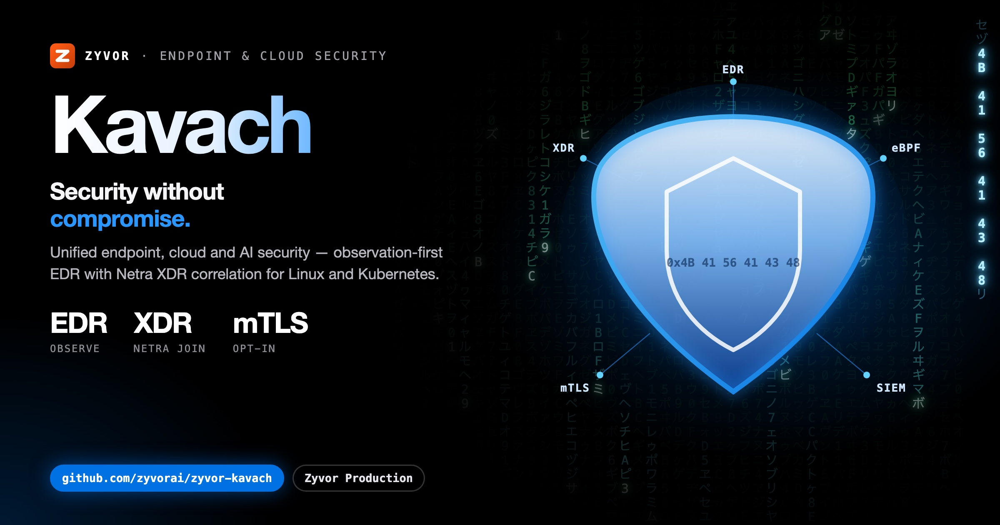

# Kavach.

[Client overview (PDF)](docs/Kavach-Client-Overview.pdf)

**Security without compromise.**

Observation-first endpoint, cloud, and AI security by [ZYVOR](https://zyvor.dev) — sister to [Netra](https://github.com/zyvorai/netra).

[](https://zyvorai.github.io/zyvor-kavach/)
[](LICENSE)
[](https://go.dev/)

<p align="center">
  
</p>

**Detect and report. Never contain.**

- **Observation only** — findings, fleet, hunt, AI assist. Containment stays a request ledger.
- **Quiet console + CLI** — Apple-style investigate UI, `kavachctl`, MCP for agents.
- **Finance & sectors** — banks, insurance, public fleets, industry, space, eBPF. Observe only.
- **Cloud, exposure, e-mail** — you send audit logs, SBOMs and messages; Kavach reads them offline and reports. It never calls a cloud API, scans a host or fetches a link.

→ **[Product docs & story](https://zyvorai.github.io/zyvor-kavach/)**

---

## Quickstart

```bash
git clone https://github.com/zyvorai/zyvor-kavach.git && cd zyvor-kavach
export KAVACH_TOKEN='Admin@321'

go run ./cmd/kavach -mode server -listen 127.0.0.1:8099
```

The token must be at least 8 characters (a warning is logged under 16). State is written under `./data/` (`-state` moves it).
`go test ./...` runs the full suite; the race variant is `go test -race -timeout 30m ./...` ([testing.md](docs/testing.md)).

Second terminal:

```bash
export KAVACH_TOKEN='Admin@321'
go run ./cmd/kavach -mode agent -url http://127.0.0.1:8099
go build -o bin/kavachctl ./cmd/kavachctl
KAVACH_URL=http://127.0.0.1:8099 ./bin/kavachctl status
open http://127.0.0.1:8099/   # username admin, password = your KAVACH_TOKEN
```

Check it end to end:

```bash
curl -s http://127.0.0.1:8099/readyz                                   # public probe
curl -s -H "Authorization: Bearer $KAVACH_TOKEN" http://127.0.0.1:8099/v1/summary
./bin/kavachctl doctor                                                 # URL, token, probes, auth, TLS hint
```

---

## Deploy

**Local**

```bash
export KAVACH_TOKEN='Admin@321'
go run ./cmd/kavach -mode server -listen 0.0.0.0:8099
```

**Kubernetes lab** (run the test gates first, see [deploy-remote.md](docs/deploy-remote.md); the script does not run tests itself)

```bash
go test -race -timeout 30m ./... && go test ./... && go vet ./...
KAVACH_ADMIN_TOKEN='use-a-real-secret' ./scripts/deploy-remote.sh sus@80.79.5.173 --k8s --envoy-gateway
# NodePort  → https://HOST:30899/
# Envoy     → https://kavach.HOST.sslip.io:30943/
```

→ [Tutorial](docs/tutorial.md) · [Remote deploy](docs/deploy-remote.md) · [Envoy](docs/envoy-gateway.md) · [mTLS](docs/agent-mtls.md)

---

## Operator surfaces

| Surface | |
|---------|--|
| **Console** | Sign in as `admin` with the controller token as password (lab default `Admin@321`) — [console.md](docs/console.md) |
| **kavachctl** | `status` · `doctor` · `watch` · `findings` · `export` · `exposure` · `fleet slo` · `finance` · `sectors` · `ebpf` — [kavachctl.md](docs/kavachctl.md), [cli-reference.md](docs/cli-reference.md) |
| **Finance** | Banks, UPI, insurance, IRDAI — never freezes money — [finance.md](docs/finance.md) |
| **Sectors** | Rail, fleets, industry, space — never immobilizes — [sectors.md](docs/sectors.md) |
| **eBPF** | Observe-only CO-RE — [ebpf.md](docs/ebpf.md) |
| **Observe** | ATT&CK matrix · compliance grade · live SSE · Prometheus — [observability.md](docs/observability.md) |
| **MCP** | Agent tooling, 425 read-only tools (499 with `KAVACH_MCP_ALLOW_MUTATIONS=true`, measured at this commit) — [mcp-integration.md](docs/mcp-integration.md) |
| **Cloud** | CloudTrail, Azure, GCP, Okta, M365 audit-log detection from logs you POST — [cloud-audit.md](docs/cloud-audit.md) |
| **Exposure** | SBOM-based software exposure, offline, SAMPLE advisories until you import data — [exposure.md](docs/exposure.md) |
| **E-mail / URL** | Parse-only analyzers, no fetching — [url-email-inspection.md](docs/url-email-inspection.md) |
| **Telemetry / syslog** | Typed events and an opt-in agentless syslog listener — [telemetry-types.md](docs/telemetry-types.md), [syslog-listener.md](docs/syslog-listener.md) |
| **SIEM** | Pull export (OCSF, ECS, CEF, LEEF, Splunk HEC, STIX, Navigator) with cursors; optional push sink — [siem-export.md](docs/siem-export.md) |
| **State** | Every on-disk file, reset and backup — [persistence-files.md](docs/persistence-files.md) |

```bash
./bin/kavachctl finance summary
./bin/kavachctl sectors public-vehicles
./bin/kavachctl ebpf health
./bin/kavachctl exposure report                       # after PUT /v1/exposure/sboms/{host}
./bin/kavachctl export findings --format ocsf         # SIEM pull export with cursor paging
```

---

## Architecture

```text
  Browser / kavachctl / MCP / SIEM
              │
              ▼
     ┌────────────────────┐
     │  kavach controller │  HTTPS :30899 / Envoy :30943
     │  findings · AI Hub │  Apple.com console · /v1/*
     │  eBPF platform API │
     └─────────┬──────────┘
               │ bearer / session / optional mTLS
     ┌─────────▼──────────┐      ┌─────────────────┐
     │  kavach agent      │      │ Netra poller /  │
     │  /proc · eBPF pins │      │ netra-bridge    │
     └────────────────────┘      └─────────────────┘
```

→ [architecture.md](docs/architecture.md)

---

## Docs

| | |
|--|--|
| [Site](https://zyvorai.github.io/zyvor-kavach/) | Story + full guides |
| [Tutorial](docs/tutorial.md) | First hour |
| [Use cases](docs/use-cases.md) | SOC, hunt, XDR |
| [Testing](docs/testing.md) | Unit, race, smoke, lab |
| [Security review](docs/security-review.md) | What was reviewed, accepted risks, gaps |
| [OpenAPI](docs/openapi.yaml) | HTTP contract |
| [Docs index](docs/index.md) | Every document by area |

```bash
go test -race -timeout 30m ./...   # CI race job (the edr package needs more than the default 10m)
go test ./...                      # full corpora, no race detector
```

---

## Honest limits

- Observation only: findings, ledgers and exports. Containment, RTR and similar APIs append request ledgers; nothing is enforced.
- Detection and similarity numbers come from **synthetic corpora** and heuristics; they are not a guarantee against real attacks.
- Reporting-regime clocks, compliance scores and framework catalogs are informational evidence, not legal advice or a certification; some items remain unverified ([verification-log.md](docs/verification-log.md)).
- The embedded advisory set used for exposure is a small SAMPLE. SIEM mappings, syslog parsers and the eBPF programs were tested with fixtures, not live vendor systems or kernels.
- Single controller replica with file-backed state; no multi-user auth (one shared token).

---

## Pricing

A commercial licence is required to run Kavach in production; a 30-day trial key is available for evaluation. A production licence is priced per endpoint per year: INR including 18% GST in India, US dollars excluding tax elsewhere:

| Plan | India (INR incl. 18% GST) | Worldwide (USD excl. tax) | Minimum |
|---|---|---|---|
| Kavach Pro | INR 3,999 per endpoint per year | USD 40 per endpoint per year | 25 endpoints (INR 99,975 / USD 1,009) |
| Kavach Enterprise | INR 6,499 per endpoint per year | USD 66 per endpoint per year | 100 endpoints (INR 649,900 / USD 6,557) |

A server counts as 3 endpoints. Volume: 256-499 endpoints -10%, 500-999 -15%, 1,000+ -20%. Multi-year: 2 years -5%, 3 years -10%. Volume and multi-year together are capped at 25%. Kavach detects and reports only; it never contains or blocks. After payment you receive a GST invoice (India) or a US-dollar invoice, and the Zyvor team issues your licence and onboarding help. A 30-day trial key is available for production evaluation. Buy or get a quote: [zyvor.dev/buy](https://zyvor.dev/buy#kavach) (online payment opens shortly). Prices: INR incl. 18% GST in India; US dollars excl. tax elsewhere (VAT, GST or sales tax added where applicable). Pay online by UPI, card or netbanking where a buy page exists; international cards work (charged in rupees). Orders of USD 5,000 or more and quotes are invoiced in USD through Skydo. Custom pricing: contact [sales@zyvor.dev](mailto:sales@zyvor.dev).

---

## Licence key (30-day trial)

Kavach verifies a signed licence key (`ZYV1.`) offline against a public key built into the binary; nothing is sent to Zyvor. A 30-day trial key from [sales@zyvor.dev](mailto:sales@zyvor.dev) applies to the paid production licence and support. Enforcement is soft: nothing is disabled when a trial or licence ends or when there is no key. Set `KAVACH_LICENCE_KEY` or put the key in `./data/licence.key` (or the file named by `KAVACH_LICENCE_FILE`). The status (`licensed`, `trial`, `licence_expired`, `unlicensed`, `invalid`) is logged at server start and returned as `licence` by `GET /v1/sensor`.

## License

Zyvor Production License v1.0 — free for a 30-day evaluation; a commercial license is required for production and after 30 days. See [LICENSE](LICENSE) and [NOTICE](NOTICE).

**Repo:** https://github.com/zyvorai/zyvor-kavach
