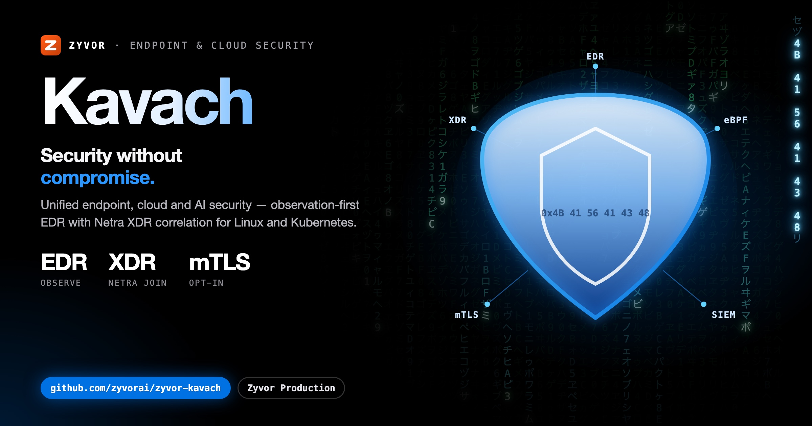

# KAVACH

**Security without compromise.**

by ZYVOR

Zyvor Kavach — Unified Endpoint, Cloud & AI Security.

[](LICENSE)
[](https://zyvorai.github.io/zyvor-kavach/)
[](https://go.dev/)
[](bpf/)

<p align="center">
  
</p>

## Quickstart

```bash
export KAVACH_TOKEN='replace-with-at-least-16-random-characters'
go test ./...
go run ./cmd/kavach -mode server
# second terminal, same token:
go run ./cmd/kavach -mode agent
curl -H "Authorization: Bearer $KAVACH_TOKEN" http://127.0.0.1:8099/v1/findings
```

## Deploy

```bash
./scripts/deploy-remote.sh sus@80.79.5.173 --k8s --envoy-gateway
# → https://HOST:30899
```

See [docs/deploy-remote.md](docs/deploy-remote.md).

## Features

Honest about what ships today:

| Capability | CrowdStrike analogue | Status |
|---|---|---|
| Insight detections + MITRE | Falcon Insight XDR | Shipping — observation only |
| Prevent IOA/IOC + policies | Falcon Prevent | Detect-only (never quarantine) |
| Device Control / Firewall inventory | Device Control / Firewall Mgmt | Visibility |
| Discover assets & apps | Falcon Discover | Shipping |
| Spotlight CVEs | Falcon Spotlight | Shipping (inventory + seeds) |
| OverWatch hunting alerts | Falcon OverWatch | Shipping (feed API) |
| Adversary intel / actors | Falcon X | Shipping |
| Identity + UEBA | Falcon Identity | Shipping |
| Fusion playbooks / cases | Falcon Fusion / NG-SIEM | Ledger-only SOAR |
| RTR diagnostics | Falcon RTR | Read-only store-backed commands |
| Host containment requests | Host Management | Request ledger — never enforced |
| Hunt (FQL-lite) + threat graph | Falcon Hunt / Threat Graph | Shipping |
| Charlotte-lite assist | Charlotte AI | Assistive triage |
| Cloud / Mobile | Falcon Cloud / Mobile | Preview stubs |
| XDR via Netra | Insight XDR network | Bridge / poller |
| SIEM export + connectors | Next-Gen SIEM | Webhook / syslog / NDJSON |
| eBPF exec sensor | Sensor | Scaffold (`bpf/`) |
| Agent mTLS / Envoy Gateway | Platform | Opt-in docs |

No automatic containment, process kill, or malware prevention is claimed. See `GET /v1/modules`.

### Lab demo

Against a running server (admin token required):

```bash
export KAVACH_URL=https://127.0.0.1:8099
export KAVACH_TOKEN='…'
./scripts/demo-lab.sh
```

API surface: [docs/openapi.yaml](docs/openapi.yaml).

## Docs

- [Architecture](docs/architecture.md)
- [Agent mTLS](docs/agent-mtls.md)
- [Envoy Gateway](docs/envoy-gateway.md)
- [Remote deploy](docs/deploy-remote.md)
- [OpenAPI stub](docs/openapi.yaml)
- Site: https://zyvorai.github.io/zyvor-kavach/

## License

Zyvor Production License v1.0 — free for evaluation and non-production use; commercial license required for production. See [LICENSE](LICENSE) and [NOTICE](NOTICE).

## Repository

https://github.com/zyvorai/zyvor-kavach
